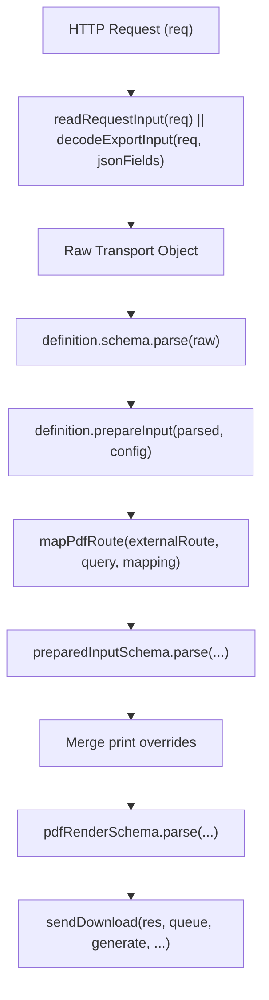
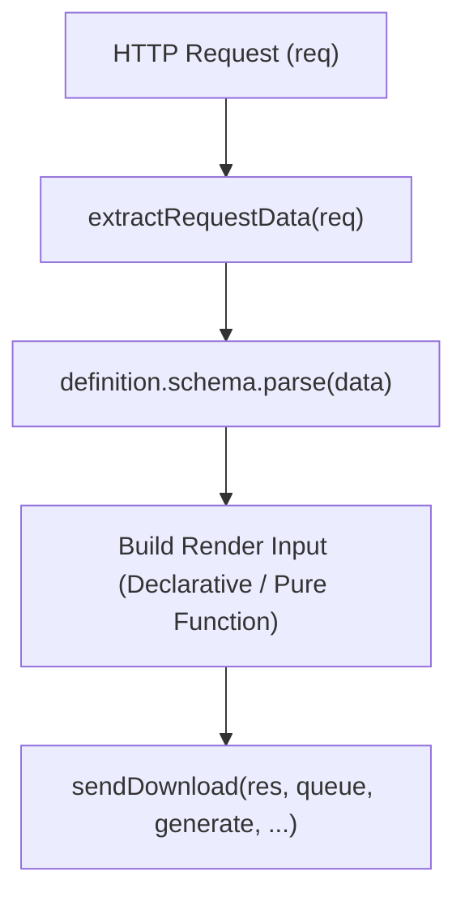

# Report abstraction layer simplification

This document outlines the design and implementation plan for simplifying Generator API's report abstraction layer. It addresses unnecessary pipeline complexity, redundant schema re-validations, and boilerplate request decoding while maintaining **small, single-purpose functions and clean separation of concerns**.

## 1. Overview and objectives

1. **Unified request extraction:** Replace custom per-route `readRequestInput` and `decodeExportInput` with a single, compact `extractRequestData` helper that combines `req.params`, `req.query`, and `req.body`, automatically parsing JSON query values on GET when formatted as arrays (`[...]`) or objects (`{...}`).
2. **Elimination of `jsonFields`:** Remove per-route `jsonFields` declarations and associated fallback branches.
3. **Streamlined execution pipeline:** Collapse the 4-stage pipeline (`readRequestInput -> schema.parse -> prepareInput -> preparedInputSchema.parse -> pdfRenderSchema.parse`) into a direct, single-pass validation and execution pipeline.
4. **Declarative route definitions:**
   - [`definePdfReport`](../../src/reports/pdf.ts) accepts route patterns, filename resolvers, and print settings directly, eliminating manual [`mapPdfRoute`](../../src/reports/pdf-route.ts) boilerplate.
   - [`definePptxReport`](../../src/reports/pptx.ts) provides a direct input mapping and filename resolver.
5. **String-keyed service registry:** Transition [`ReportServices`](../../src/reports/services.ts) from opaque object-identity keys (`Map<object, Entry>`) to explicit report names (e.g. `'daa'`, `'tma'`, `'brief'`), simplifying route registration, startup template validation, and test mocking via `reports.override('brief', fakeService)`.
6. **File organization:** Preserve the 3-file modular layout (`schema.ts`, `report.ts`, `get.ts`) so each file remains small (~15–35 lines) and focused on a single responsibility, while eliminating redundant intermediate wrapper code.

---

## 2. Architecture comparison

### Current request pipeline



### Simplified request pipeline



---

## 3. Core component specifications

### 3.1. Unified request extractor (`src/http/input.ts`)

A standalone helper function (~25 lines) replacing `decodeExportInput`:

```typescript
import type { Request } from 'express';

/** Parses JSON query strings if they start with object or array delimiters. */
function parseQueryValue(value: unknown): unknown {
  if (typeof value !== 'string') return value;
  const trimmed = value.trim();
  if (
    (trimmed.startsWith('{') && trimmed.endsWith('}')) ||
    (trimmed.startsWith('[') && trimmed.endsWith(']'))
  ) {
    try {
      return JSON.parse(trimmed);
    } catch {
      return value;
    }
  }
  return value;
}

/** Extracts a normalized, flat input record from Express request params, query, and body. */
export function extractRequestData(req: Request): Record<string, unknown> {
  const query: Record<string, unknown> = {};
  for (const [key, val] of Object.entries(req.query)) {
    query[key] = parseQueryValue(val);
  }
  return {
    ...query,
    ...req.params,
    ...(req.body && typeof req.body === 'object' ? req.body : {}),
  };
}
```

---

### 3.2. Declarative PDF report helper (`src/reports/pdf.ts`)

Eliminates intermediate Zod schemas and declarative boilerplate:

```typescript
import { sendDownload } from '@/http/download';
import { extractRequestData } from '@/http/input';
import {
  pdfOriginSchema,
  pdfPrintOverridesSchema,
} from '@/services/pdf/contracts';

import type { ZodType } from 'zod';
import type { RouteFactory } from '@/http/file-routes/types';
import type {
  PdfPrintOverrides,
  PdfRenderInput,
} from '@/services/pdf/contracts';

export interface PdfReportDefinition<Input> {
  schema: ZodType<Input>;
  route: string | ((input: Input) => string);
  filename: string | ((input: Input) => string);
  print?: PdfPrintOverrides;
  externalOrigin?: string;
  waitForSelector?: string;
  forwardQuery?: boolean | readonly (keyof Input)[];
}

export function definePdfReport<Input>(
  definition: PdfReportDefinition<Input>,
): RouteFactory {
  const origin = definition.externalOrigin
    ? pdfOriginSchema.parse(definition.externalOrigin)
    : undefined;
  const print = definition.print
    ? pdfPrintOverridesSchema.parse(definition.print)
    : undefined;

  return (dependencies) => async (req, res) => {
    const rawData = extractRequestData(req);
    const input = definition.schema.parse(rawData);

    const targetRoute =
      typeof definition.route === 'function'
        ? definition.route(input)
        : definition.route;

    const filename =
      typeof definition.filename === 'function'
        ? definition.filename(input)
        : definition.filename;

    const query: PdfRenderInput['query'] = {};
    if (definition.forwardQuery) {
      const allowedKeys =
        definition.forwardQuery === true
          ? (Object.keys(input as object) as (keyof Input)[])
          : definition.forwardQuery;

      for (const key of allowedKeys) {
        const val = input[key];
        if (val !== undefined && typeof key === 'string') {
          query[key] = String(val);
        }
      }
    }

    const renderInput: PdfRenderInput = {
      route: targetRoute,
      filename,
      query,
      ...(definition.waitForSelector && {
        waitForSelector: definition.waitForSelector,
      }),
      ...(print && { print, landscape: print.landscape, format: print.format }),
    };

    await sendDownload(
      res,
      dependencies.queues.pdf,
      () => dependencies.pdf.generate(renderInput, origin),
      filename,
      'pdf',
    );
  };
}
```

---

### 3.3. Declarative PPTX report helper (`src/reports/pptx.ts`)

Connects string-keyed services directly to downloads:

```typescript
import { AppError } from '@/errors';
import { sendDownload } from '@/http/download';
import { extractRequestData } from '@/http/input';
import { filenameSchema } from '@/validation/filename';

import type { ZodType } from 'zod';
import type { RouteFactory } from '@/http/file-routes/types';
import type { ReportContext, ReportService } from './services';

export interface PptxReportDefinition<Input, RenderInput = Input> {
  name: string;
  schema: ZodType<Input>;
  filename: string | ((input: Input) => string);
  toServiceInput?: (input: Input) => RenderInput;
  createService?: (context: ReportContext) => ReportService<RenderInput>;
  notConfiguredMessage?: string;
}

export function definePptxReport<Input, RenderInput = Input>(
  definition: PptxReportDefinition<Input, RenderInput>,
): RouteFactory {
  return (dependencies) => {
    if (definition.createService && dependencies.reports) {
      dependencies.reports.register(definition.name, definition.createService);
    }

    return async (req, res) => {
      const rawData = extractRequestData(req);
      const input = definition.schema.parse(rawData);

      const service = dependencies.reports?.get<RenderInput>(definition.name);
      if (!service) {
        throw new AppError(
          404,
          'UNKNOWN_TEMPLATE',
          definition.notConfiguredMessage ??
            `PowerPoint report "${definition.name}" not configured`,
        );
      }

      const rawFilename =
        typeof definition.filename === 'function'
          ? definition.filename(input)
          : definition.filename;
      const filename = filenameSchema.parse(rawFilename);

      const serviceInput = definition.toServiceInput
        ? definition.toServiceInput(input)
        : (input as unknown as RenderInput);

      await sendDownload(
        res,
        dependencies.queues.presentations,
        () => service.generate(serviceInput),
        filename,
        'pptx',
      );
    };
  };
}
```

---

### 3.4. String-keyed ReportServices registry (`src/reports/services.ts`)

Replaces `Map<object, Entry>` with `Map<string, Entry>`:

```typescript
export class ReportServices {
  private readonly factories = new Map<
    string,
    (ctx: ReportContext) => ReportService<unknown>
  >();
  private readonly entries = new Map<string, Entry>();
  private readonly overrides = new Map<string, unknown>();

  register<Input>(
    name: string,
    factory: (ctx: ReportContext) => ReportService<Input>,
  ): this {
    if (!this.factories.has(name)) {
      this.factories.set(
        name,
        factory as (ctx: ReportContext) => ReportService<unknown>,
      );
    }
    return this;
  }

  override<Input>(name: string, service: ReportService<Input>): this {
    if (this.entries.has(name) || this.initialization || this.closing) {
      throw new Error('Override report services before registering routes');
    }
    this.overrides.set(name, service);
    return this;
  }

  get<Input>(name: string): ReportService<Input> {
    if (this.closing) throw new Error('Report services are shutting down');
    const existing = this.entries.get(name);
    if (existing) return existing.service as ReportService<Input>;

    const override = this.overrides.get(name) as
      ReportService<Input> | undefined;
    const factory = this.factories.get(name);
    if (!override && !factory) {
      throw new Error(`Report service not registered: ${name}`);
    }

    const service =
      override ?? (factory!(this.context) as ReportService<Input>);
    this.entries.set(name, {
      service,
      validate: async () => {
        if (!override) await service.validate?.();
      },
      close: async () => {
        if (!override) await service.close?.();
      },
    });
    return service;
  }
}
```

---

## 4. Route comparisons

### 4.1. Quarterly PDF route (`src/routes/pdf/quarterly/`)

#### Before: `schema.ts` and `report.ts`

```typescript
// schema.ts
const querySchema = z
  .object({
    year: z
      .string()
      .regex(/^\d{4}$/)
      .default('2026'),
    quarter: z.enum(['1', '2', '3', '4']).default('3'),
    language: z.enum(['en', 'de', 'pl']).default('en'),
  })
  .strict();

export const requestSchema = z.object({ query: querySchema }).strict();

// report.ts
export default definePdfReport({
  schema: requestSchema,
  readRequestInput: (req) => ({ query: req.query }),
  prepareInput: ({ query }) => ({
    ...mapPdfRoute('/reports/quarterly', query, {
      year: 'year',
      quarter: 'quarter',
      language: 'language',
    }),
    filename: `quarterly-${query.year}-q${query.quarter}-${query.language}`,
    waitForSelector: '[data-report-ready]',
  }),
  print: { landscape: false },
});
```

#### After: `schema.ts` and `report.ts`

```typescript
// schema.ts
export const requestSchema = z
  .object({
    year: z
      .string()
      .regex(/^\d{4}$/)
      .default('2026'),
    quarter: z.enum(['1', '2', '3', '4']).default('3'),
    language: z.enum(['en', 'de', 'pl']).default('en'),
  })
  .strict();

// report.ts
export default definePdfReport({
  schema: requestSchema,
  route: '/reports/quarterly',
  filename: ({ year, quarter, language }) =>
    `quarterly-${year}-q${quarter}-${language}`,
  forwardQuery: ['year', 'quarter', 'language'],
  waitForSelector: '[data-report-ready]',
  print: { landscape: false },
});
```

---

### 4.2. Factsheet PDF route with dynamic path (`src/routes/pdf/factsheet/[id]/`)

#### Before: `report.ts`

```typescript
const externalRoute = pdfRoutePatternSchema.parse('/factsheet/{id}');

export default definePdfReport({
  schema: requestSchema,
  readRequestInput: (req) => ({ id: req.params.id, query: req.query }),
  prepareInput: ({ id, query }) => ({
    ...mapPdfRoute(resolvePdfRoute(externalRoute, id), query, {}),
    filename: id,
  }),
  print: { landscape: false },
});
```

#### After: `report.ts`

```typescript
export default definePdfReport({
  schema: requestSchema,
  route: ({ id }) => `/factsheet/${id}`,
  filename: ({ id }) => id,
  print: { landscape: false },
});
```

---

### 4.3. PPTX DAA template route (`src/routes/pptx/daa/`)

#### Before: `report.ts`

```typescript
export const report = {
  schema: requestSchema,
  notConfiguredMessage: 'Template report demo not configured',
  readRequestInput,
  prepareInput: ({ TEXT_ME }) => ({
    filename: 'demo-report',
    input: TEXT_ME,
  }),
  createService: () => new DaaPocPresentationService(templateFile(sourceFile)),
} satisfies PptxReport<z.infer<typeof requestSchema>, string>;

export default definePptxReport(report);
```

#### After: `report.ts`

```typescript
export default definePptxReport({
  name: 'daa',
  schema: requestSchema,
  filename: 'demo-report',
  toServiceInput: ({ TEXT_ME }) => TEXT_ME,
  createService: () => new DaaPocPresentationService(templateFile('daa.pptx')),
});
```

---

## 5. Implementation steps and verification

### Step 1: Request extraction refactor

- Update [`src/http/input.ts`](../../src/http/input.ts) with `extractRequestData`.
- Deprecate/remove `decodeExportInput`.

### Step 2: Helpers refactor

- Update [`src/reports/pdf.ts`](../../src/reports/pdf.ts) with declarative route definition and query forwarding.
- Update [`src/reports/pptx.ts`](../../src/reports/pptx.ts) with string-name registration.
- Update [`src/reports/services.ts`](../../src/reports/services.ts) to support string-keyed names and test overrides.

### Step 3: Route simplification

- Refactor PDF routes:
  - `src/routes/pdf/quarterly/`
  - `src/routes/pdf/factsheet/[id]/`
  - `src/routes/pdf/onepager/[id]/`
  - `src/routes/pdf/example/`
- Refactor PPTX routes:
  - `src/routes/pptx/daa/`
  - `src/routes/pptx/tma/`
  - `src/routes/pptxgenjs/brief/`

### Step 4: Verification (static checks)

Per repository guidelines, static checks ensure strict type safety, import consistency, and export validity:

```bash
npm run typecheck
npm run lint:code
npm run knip
```
